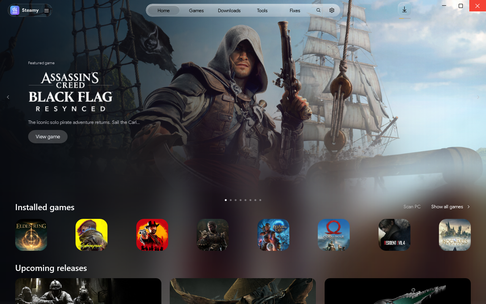

<h1 align="center">Steamy</h1>
<p align="center">Your games, downloads and tools in one Windows app.</p>

<p align="center">
  <a href="https://github.com/ZazaJr24/Steamy/releases/latest"></a>
  <a href="https://github.com/ZazaJr24/Steamy/stargazers"></a>
  <a href="https://github.com/ZazaJr24/Steamy/releases"></a>
</p>

<p align="center">
  <a href="https://github.com/ZazaJr24/Steamy/releases/download/v0.7.1.2/Steamy-v0.7.1.2-Setup.exe"><strong>Download Setup · 1.84 MiB</strong></a> &nbsp;·&nbsp;
  <a href="https://github.com/ZazaJr24/Steamy/releases/download/v0.7.1.2/Steamy-v0.7.1.2.zip"><strong>Portable ZIP</strong></a> &nbsp;·&nbsp;
  <a href="https://github.com/ZazaJr24/Steamy/releases/tag/v0.7.1.2">Release notes</a> &nbsp;·&nbsp;
  <a href="https://discord.gg/npWpm73z4B">Discord</a>
</p>



## What's new in 0.7.1.2

- Fix the local ZIP/Lua picker closing the installation menu. Selecting or cancelling a file now keeps the game page and installation steps open.
- Retain the 0.7.0 artwork ambient, fades and glass interface.
- Faster browsing and search, with cached game artwork.
- Game details and installation steps for **Steamy** or **Steam**.
- Clearer download progress, queue controls and scrolling fixes.
- UC Online settings, backups and improved DepotBox imports.
- Small download setup and a complete portable package.

The setup hotfix removes the unsupported XStoreUnlocker download and the obsolete Unsteam launcher. Hypervisor support is planned for **0.8.0**. [Full changelog →](CHANGELOG.md)

## Get started

Requires **Windows 10 or 11, 64-bit**.

**Setup:** run the installer and choose a folder. Steamy and eight supported tool components are downloaded from GitHub. Missing Microsoft prerequisites come from Microsoft's official sources.

**Portable:** extract the ZIP and run `Steamy.exe`. The .NET runtime is included; keep the extracted files and `Tools` folder together.

The `app.zip` asset is for Setup to download automatically. Some providers require a key in Settings. [Report a bug →](https://github.com/ZazaJr24/Steamy/issues)

<details>
<summary>Build from source</summary>

Use Windows and the .NET SDK specified in [global.json](global.json).

```powershell
git clone https://github.com/ZazaJr24/Steamy.git
cd Steamy
dotnet build Steamy.sln -c Release
dotnet test tests/Steamy.Tests/Steamy.Tests.csproj -c Release
$env:STEAMY_UI_LIBRARY_INSTALL_OFFSCREEN_ONLY = '1'
dotnet test tests/Steamy.UiTests/Steamy.UiTests.csproj -c Release
./scripts/package-distribution.ps1
```

</details>

## Community

Join the [Steamy Discord server](https://discord.gg/npWpm73z4B) for discussion, feedback and update announcements. For bug reports, please use [GitHub Issues](https://github.com/ZazaJr24/Steamy/issues).

## Credits

Created and maintained by [ZazaJr24](https://github.com/ZazaJr24).

Special thanks to **Mstra**, **yima3** and **teachervituu**.

Thanks to the authors of the tools and libraries used by Steamy. Their credits, licenses and provenance are listed in [THIRD-PARTY-NOTICES.md](THIRD-PARTY-NOTICES.md). The maintained downloader source is in [tools/DepotDownloaderMod](tools/DepotDownloaderMod).

## License

Steamy uses the [Steamy Proprietary Software License](LICENSE). Third-party components retain their own licenses. Steam and game artwork belong to their respective owners; Steamy is an independent project.
