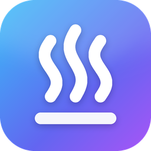
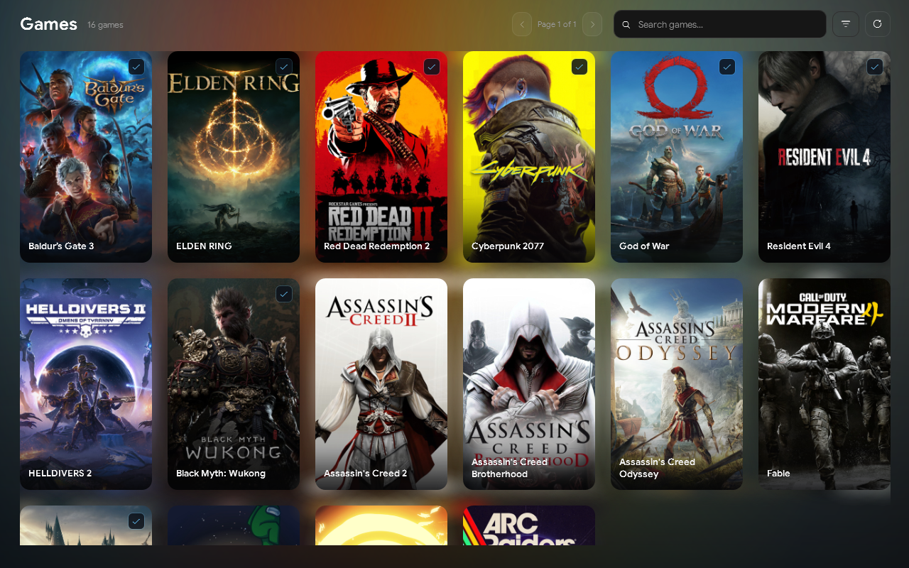
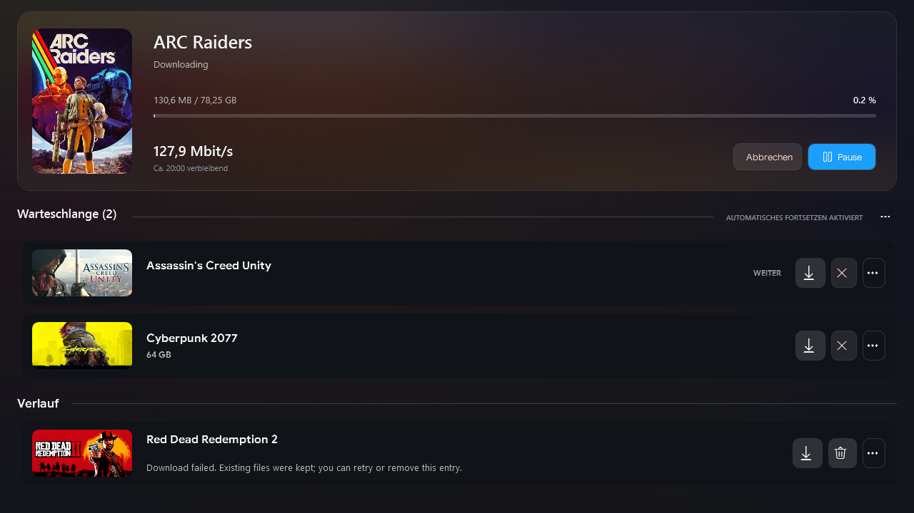
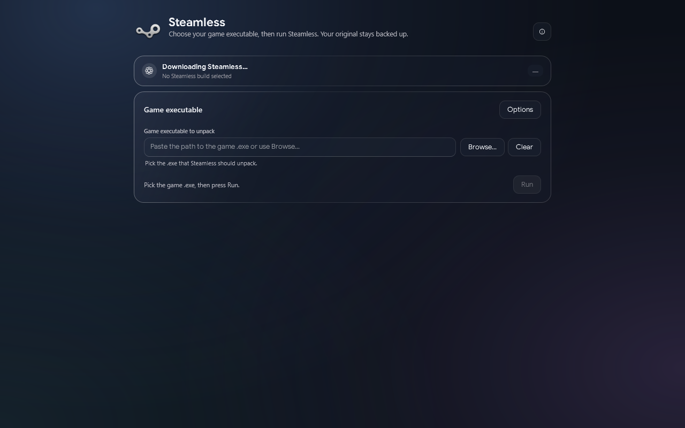

<p align="center">
  
</p>

<h1 align="center">Steamy</h1>

<p align="center">
  <strong>Browse your games. Manage your downloads. Set up your tools.</strong>
</p>

<p align="center">
  A Windows desktop app for your installed Steam and PC games, game downloads,<br />
  and tools such as Steamless and Goldberg — together in one interface.
</p>

<p align="center">
  <a href="https://github.com/ZazaJr24/Steamy/releases/latest"></a>
  <a href="https://discord.gg/npWpm73z4B"></a>
</p>

<p align="center">
  <sub>Windows 10 / 11 · 64-bit · Installer or portable ZIP</sub>
</p>

<p align="center">
  <a href="https://github.com/ZazaJr24/Steamy/stargazers"></a>
  <a href="https://github.com/ZazaJr24/Steamy/releases"></a>
</p>

<p align="center">
  <a href="#what-steamy-does">Features</a> &nbsp;·&nbsp;
  <a href="#get-started">Get started</a> &nbsp;·&nbsp;
  <a href="#screenshots">Screenshots</a> &nbsp;·&nbsp;
  <a href="CHANGELOG.md">Changelog</a>
</p>

---

<p align="center">
  <a href="docs/screenshots/dashboard.png"></a>
  <br />
  <sub>Featured games, your installed library and upcoming releases.</sub>
</p>

## What Steamy does

Steamy is for Windows players who want to handle their game library, downloads and tool settings from the same app.

- **Find and play your games.** Scan Steam, Epic, GOG and standalone game folders. Launch installed games, see play time and manage notes and launch options.
- **Discover your next game.** Browse the Steam catalog, view screenshots and system requirements, and find recommendations based on your installed library.
- **Keep downloads organised.** Choose a supported source or import a local ZIP/Lua package. Follow transfer progress, speed and remaining time, and manage the queue.
- **Configure game tools.** Dedicated pages guide you through Steamless, Goldberg, GreenLuma, UC Online and DLC tool settings.

Downloads depend on the source and files available for each game. Some sources need an account or API key in **Settings**. Steam integration uses your installed Steam client.

## Get started

Requires **Windows 10 or 11, 64-bit**. Open the [latest release](https://github.com/ZazaJr24/Steamy/releases/latest) and choose a package:

- **Setup — guided installation.** Download the file ending in `-Setup.exe`, run it and choose an installation folder. Setup downloads the app and supported tools from GitHub, plus any missing Microsoft prerequisites from Microsoft's official sources. An internet connection is required.
- **Portable — extract and run.** Download `Steamy-v*.zip` without the `-app` suffix, extract it and open `Steamy.exe`. The .NET runtime is included; keep the extracted files and `Tools` folder together.

### Your first session

1. Follow the setup prompts to choose your Steam and download folders and find installed games. You can scan a folder or all drives, and scan again later from **Home**.
2. Open **Games → Your games** to launch an installed game, or **Browse all** to explore the Steam catalog and its available installation steps.
3. Use **Downloads** to check transfers and manage queued jobs. Open **Tools** when you want to configure a game tool.

## Screenshots

<details>
<summary><strong>Explore the library, download queue and tools</strong></summary>

### Game library

[](docs/screenshots/games.png)

### Download queue

[](docs/screenshots/downloads.png)

### Steamless

[](docs/screenshots/steamless-page.png)

</details>

## Community

Join [Discord](https://discord.gg/npWpm73z4B) for discussion and feedback, or [open a GitHub issue](https://github.com/ZazaJr24/Steamy/issues) to report a bug. Release changes live in the [changelog](CHANGELOG.md).

<details>
<summary><strong>Build from source</strong></summary>

Use Windows and the .NET SDK specified in [global.json](global.json).

```powershell
git clone https://github.com/ZazaJr24/Steamy.git
cd Steamy
dotnet build Steamy.sln -c Release
dotnet test tests/Steamy.Tests/Steamy.Tests.csproj -c Release
$env:STEAMY_UI_LIBRARY_INSTALL_OFFSCREEN_ONLY = '1'
dotnet test tests/Steamy.UiTests/Steamy.UiTests.csproj -c Release
./scripts/package-distribution.ps1
```

</details>

<details>
<summary><strong>Credits</strong></summary>

Created and maintained by [ZazaJr24](https://github.com/ZazaJr24).

Special thanks to **Mstra**, **yima3** and **teachervituu**.

Thanks to the authors of the tools and libraries used by Steamy. Their credits, licenses and provenance are listed in [THIRD-PARTY-NOTICES.md](THIRD-PARTY-NOTICES.md). The maintained downloader source is in [tools/DepotDownloaderMod](tools/DepotDownloaderMod).

</details>

---

Steamy uses the [Steamy Proprietary Software License](LICENSE). Third-party components retain their own licenses. Steam and game artwork belong to their respective owners; Steamy is an independent project.
