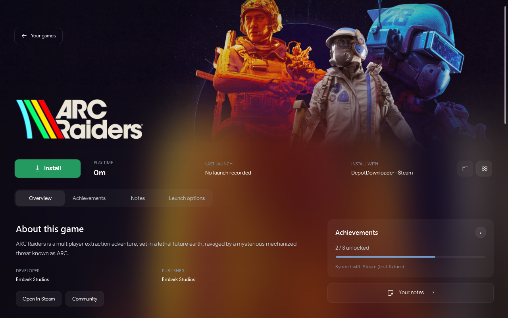
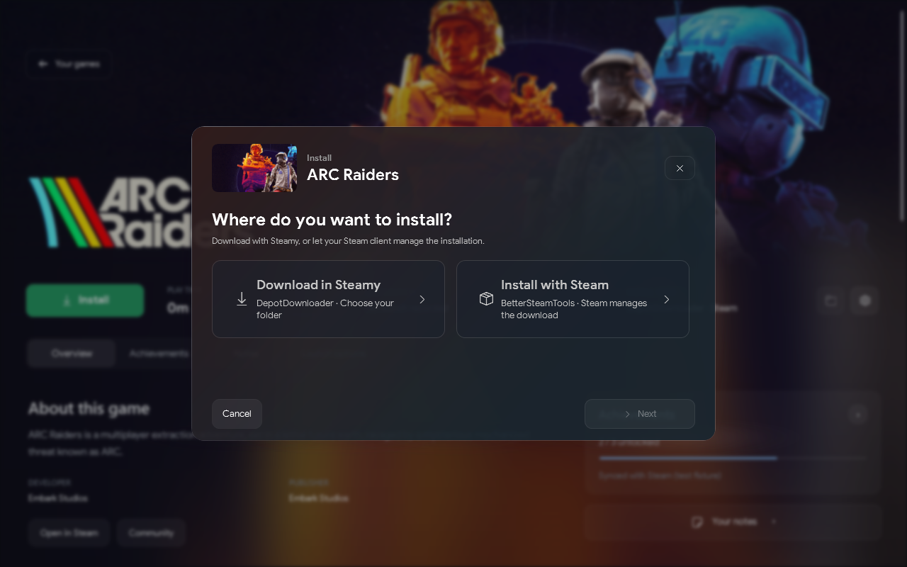
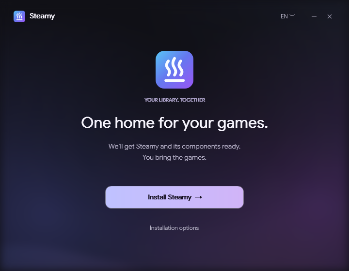
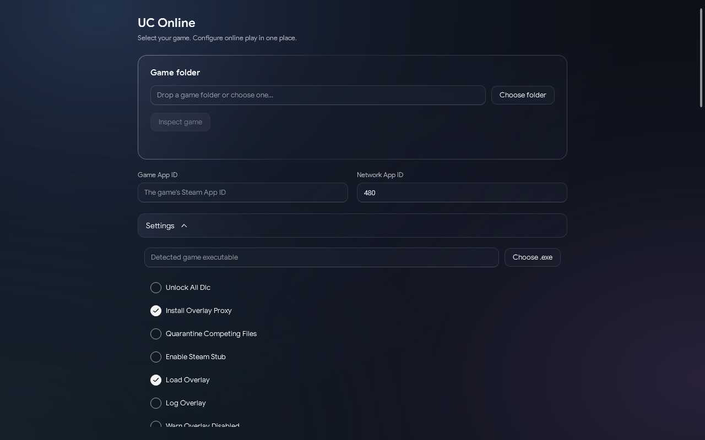

# Steamy

A Windows app for browsing games, managing downloads and using game tools.

**[Setup · 1.84 MiB](https://github.com/ZazaJr24/Steamy/releases/download/v0.7.0/Steamy-v0.7.0-Setup.exe)** · **[Portable ZIP](https://github.com/ZazaJr24/Steamy/releases/download/v0.7.0/Steamy-v0.7.0.zip)** · [Release notes](https://github.com/ZazaJr24/Steamy/releases/tag/v0.7.0) · [Report a bug](https://github.com/ZazaJr24/Steamy/issues)


## Install

Requires **Windows 10 or 11, 64-bit**.

- **Setup:** run the small installer and choose a folder. It downloads Steamy and eight supported tool components from GitHub, then installs missing Microsoft prerequisites from Microsoft's official sources.
- **Portable:** extract the ZIP and run `Steamy.exe`. The .NET runtime is included. Keep the extracted files and `Tools` folder together.

The `app.zip` release asset is downloaded automatically by Setup; you do not need to download it yourself. Some providers require a key configured in Settings.

## What's new in 0.7.0

- Artwork ambient, softer fades and a more consistent glass interface.
- Game pages open before installation. Choose **Download in Steamy** or **Install with Steam**, then follow the installation steps.
- Faster catalog browsing and search, with cached artwork.
- Download status on the game page, clearer queue actions and scrolling fixes.
- UC Online configuration with folder selection, App IDs, settings and backups.
- DepotBox imports preserve the original provider script for Steam-client installation.
- A small download installer and a complete portable package.

The setup hotfix removes the unsupported XStoreUnlocker download and the obsolete Unsteam launcher. Hypervisor support is planned for **0.8.0**.

See the [full changelog](CHANGELOG.md) for details.

## Screenshots

### Game page



### Installation



### Downloads


<details>
<summary>Setup and tools</summary>






</details>

Screenshots use the current Windows controls with sample data and public game artwork. They are rendered offscreen. Game artwork belongs to the respective publishers.

## Build

Use Windows and the .NET SDK specified in [global.json](global.json).

```powershell
git clone https://github.com/ZazaJr24/Steamy.git
cd Steamy
dotnet build Steamy.sln -c Release
dotnet test tests/Steamy.Tests/Steamy.Tests.csproj -c Release
$env:STEAMY_UI_LIBRARY_INSTALL_OFFSCREEN_ONLY = '1'
dotnet test tests/Steamy.UiTests/Steamy.UiTests.csproj -c Release
./scripts/package-distribution.ps1
```

## Credits and license

Maintained by [ZazaJr24](https://github.com/ZazaJr24). Steamy is independent of Valve and Steam.

Tool and library credits, licensing and provenance are listed in [THIRD-PARTY-NOTICES.md](THIRD-PARTY-NOTICES.md). The maintained downloader source is in [tools/DepotDownloaderMod](tools/DepotDownloaderMod).

Steamy is distributed under the [Steamy Proprietary Software License](LICENSE). Third-party components retain their own licenses.
